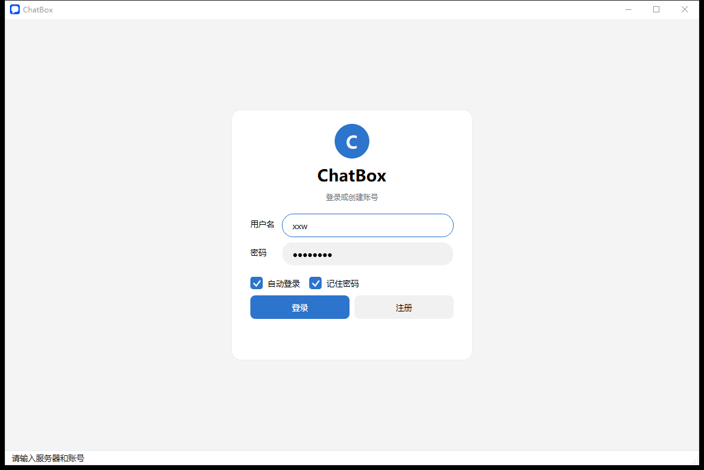
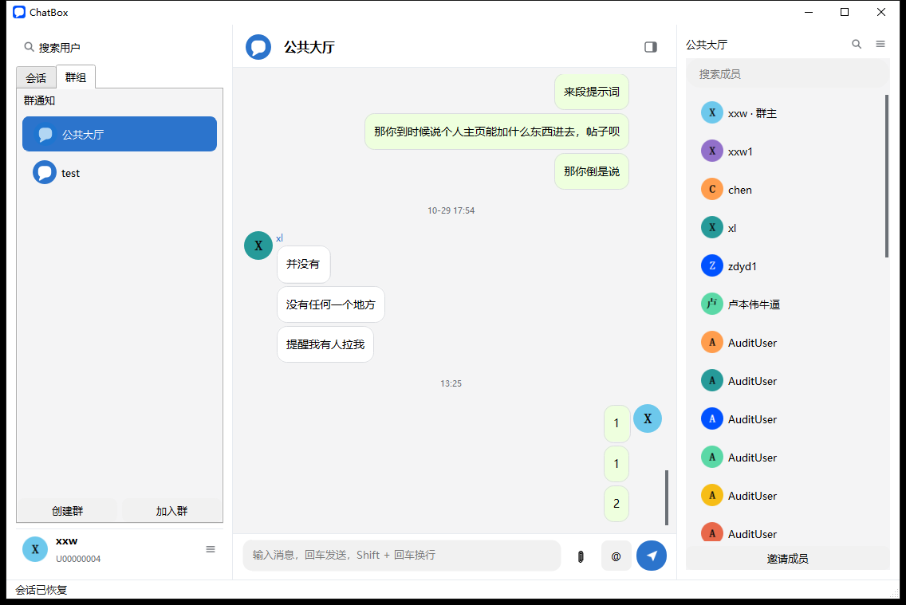
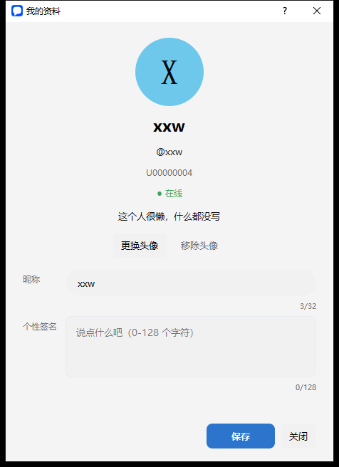
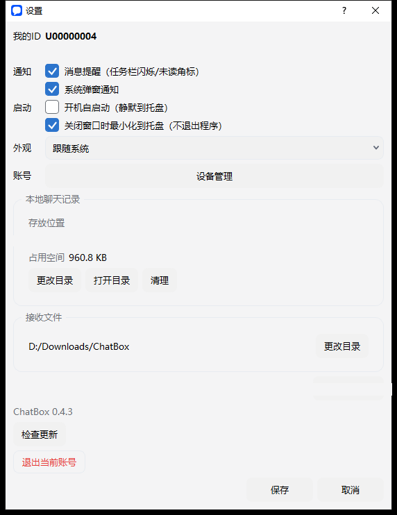

# ChatBox

[](LICENSE)

C++ 聊天室：Windows 端 Qt 5.15 桌面客户端 + Linux C++17 高并发服务端（epoll ET + MySQL + nginx TLS 终结）。

- 客户端：Qt Widgets、原生 Winsock + 独立网络线程、明暗双主题三栏聊天界面、原生 TCP + TLS、本地历史 + 离线只读（SQLite 本机副本，只落服务端已确认消息；离线可浏览、可在当前会话内搜索，保留 token 时自动重连）；多设备在线、已读同步、私聊回显、设备管理。
- 服务端：IO 线程池 + 业务工作线程池、MySQL 连接池（每线程独立连接 / 预处理语句）、心跳与断线重连、限流与连接上限；多设备会话与按会话游标同步。
- 协议：自定义二进制帧（14 字节大端帧头 + TLV 消息体），登录/注册、房间与大厅广播、私聊、历史分页、引用回复、撤回、消息搜索、好友与备注、个人资料与头像。

> **开发方式**：本项目为 vibe coding 实践，代码主要由 AI 助手 **DeepSeek** 编写，开发过程使用 [Superpowers](https://github.com/obra/superpowers) 技能包；详见[「开发方式」](#开发方式)。

## 目录结构

```text
├── chatbox/
│   ├── client/          # Qt 5.15 客户端（qmake + MinGW），含 QtTest 回归与截图（`screenshots/`）
│   ├── server/          # Linux 服务端（CMake，epoll + MySQL + Argon2id + OpenSSL）
│   ├── common/          # 协议编解码、命令字、错误码（客户端共用）
│   ├── tools/           # 协议级联调/压测脚本（Python）、run_server.sh
│   ├── deploy/          # systemd、logrotate、nginx stream、证书脚本、建库/迁移 SQL
│   ├── conf/            # 环境配置示例（真实口令不入库）
│   └── tests/           # 服务端 CTest 用例
├── docs/                # 设计与实施文档（docs/superpowers/ 为规格与计划）
└── README.md
```

## 快速开始

### 1. 服务端（Linux，Ubuntu 20.04+，GCC 9+）

```bash
sudo apt-get install -y cmake g++ libmysqlclient-dev libargon2-dev libssl-dev
sudo mysql < chatbox/deploy/schema.sql      # 建库 chatbox + 建表
cd chatbox
cmake -S . -B build -DCMAKE_BUILD_TYPE=Release
cmake --build build -j"$(nproc)"
(cd build && ctest --output-on-failure)     # CTest 5/5
cp conf/chatbox.env.example conf/chatbox.env   # 写入 CHATBOX_DB_PASSWORD=...
./tools/run_server.sh --listen 127.0.0.1 --port 9100 --proxy-protocol
```

完整的数据库账号、systemd、nginx stream TLS（9443）与联调工具用法见 [`chatbox/README.md`](chatbox/README.md)。

### 2. 客户端（Windows，Qt 5.15.2 + MinGW 8.1）

```powershell
cd chatbox\client
.\build_client.ps1
.\build\release\chatbox.exe
```

- 默认服务器：`192.168.2.240:9443`（TLS，校验 `client\certs\ca.crt`）。
- 回归测试：`cd chatbox\client\tests; .\run_client_tests.ps1`（当前 126 passed / 0 failed）。
- 便携分发包：`.\package_client.ps1` → `dist\chatbox-0.2.0-win64.zip`（含 `Qt5Sql.dll`、`sqldrivers\qsqlite.dll`、`imageformats\qjpeg.dll`，打包后逐项校验）。
- 详细说明见 [`chatbox/client/README.md`](chatbox/client/README.md)。

## 部署拓扑

```text
Qt 客户端 --TLS 9443--> nginx stream（证书 /etc/chatbox/certs）--PROXY--> 127.0.0.1:9100 服务端 --> MySQL(chatbox)
```

- 服务端只监听回环，systemd 服务名 `chatbox`，日志 `logs/chatbox.log`（logrotate 按天/100M 轮转）。
- 自签 CA 与内网 IP 仅用于内网开发环境；换 IP/域名需重新签发证书并同步客户端 `ca.crt`。

## 截图

| 登录 | 聊天（大厅） |
|---|---|
|  |  |

| 个人资料 | 设置 |
|---|---|
|  |  |

更多界面与验证证据（私聊、消息操作、搜索、好友、头像等）见 `chatbox/client/screenshots/` 下的 `ui-*.png` 与[截图索引](chatbox/client/screenshots/README.md)。

## 文档

| 文档 | 内容 |
|---|---|
| [`chatbox/README.md`](chatbox/README.md) | 服务端：依赖、建库、配置、构建、运行、systemd、监控指标、协议表、联调工具 |
| [`chatbox/client/README.md`](chatbox/client/README.md) | 客户端：构建、分发、TLS、各功能说明、回归测试、截图索引 |
| [`chatbox/client/screenshots/README.md`](chatbox/client/screenshots/README.md) | 客户端界面截图索引（`ui-*.png`） |
| [`chatbox/docs/design/DESIGN.md`](chatbox/docs/design/DESIGN.md) | 设计系统：颜色令牌、明暗主题、组件与可访问性规范 |
| [`AGENTS.md`](AGENTS.md) | C++ 跨平台开发规范（Qt 客户端 + Linux/Windows 服务端 + Socket + MySQL 5.7），可供其他项目参考学习 |
| [`docs/2026-10-18-linux-chatroom-design.md`](docs/2026-10-18-linux-chatroom-design.md) | 服务端架构规划书（历史设计稿，保留原始命名） |
| [`docs/superpowers/specs/`](docs/superpowers/specs) | 各功能的规格（换肤、图标、客户端可用性等） |
| [`docs/superpowers/plans/`](docs/superpowers/plans) | 对应的实施计划与台账 |
| [`docs/ssh-key-only.md`](docs/ssh-key-only.md) | 部署机 SSH 仅密钥登录配置记录 |

## 说明

- 客户端不直连服务端 MySQL；所有数据操作经服务端命令字。本地仅保留一份 SQLite 本机副本（`history.sqlite`，按 `user_id` 分区；在线写穿透、离线只读浏览）。
- 网络传输一律大端序列化，禁止直接发送内存结构体。
- Token 只存哈希（`SHA-256`），密码使用 Argon2id；日志不打印口令与 Token。
- 本仓库为个人学习/演示项目，以 [MIT 许可证](LICENSE) 开源。

## 项目目的

- **版本管理**：完整记录 ChatBox 从设计、实现到持续迭代的过程，保留每一次提交与文档演进。
- **参考学习**：仓库保留了客户端与服务端源码、协议设计、部署脚本和开发文档，供对 C++ 网络编程、Qt 桌面开发感兴趣的朋友参考。
- 项目仍在持续完善，代码和文档难免有不足之处，欢迎交流与指正。

## 开发方式

- 本项目采用 **vibe coding** 方式开发：需求、技术决策与验收由仓库所有者完成，代码主要由 AI 助手 **DeepSeek**（DeepSeek V4.1 Flash）编写。
- 开发过程使用 [Superpowers](https://github.com/obra/superpowers) 技能包，覆盖头脑风暴、方案设计、计划执行、调试与代码评审等环节。
- 仓库的日常提交、推送与文档维护同样由 **DeepSeek V4.1 Flash** 在所有者授权下完成。

## 代码规范

本仓库遵循 [`AGENTS.md`](AGENTS.md) 中的 **C++ 跨平台开发规范**，覆盖：

- 部署架构：Qt 客户端 + Linux/Windows 服务端 + 原生 Socket + MySQL 5.7
- 基础编码：C++17、命名与缩进、RAII、固定宽度类型
- Qt 客户端：线程模型、信号槽、Winsock
- 服务端：epoll / IOCP、网络字节序、IO 线程池与业务线程池分离
- MySQL：每线程独立连接、预处理语句、禁止拼接 SQL
- 部署、日志、错误处理与禁止行为清单

这份规范同样适用于其他 C++ 跨平台项目，欢迎参考、学习和交流。

## 仓库管理

- **所有者**：xxw
- **全权管理**：本仓库由 AI 助手 **DeepSeek V4.1 Flash** 在所有者授权下全权管理，包括日常提交、推送、文档维护与仓库设置。
- **管理约定**：只做增量修改、不强制推送、不改写历史；所有变更通过 `main` 分支提交推送。
